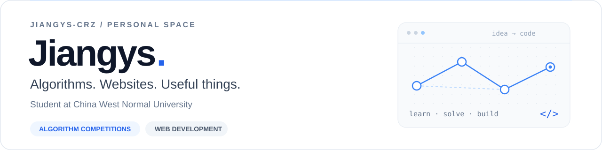

  

  <strong>西华师范大学在校生 · 算法竞赛爱好者 · Web 开发实践者</strong>

  用代码打磨思路，把想法做成可用的工具。

  <a href="https://www.cnblogs.com/zyihan-crz"><strong>技术博客 ↗</strong></a>
  &nbsp;·&nbsp;
  <a href="https://github.com/Jiangys-Crz?tab=repositories"><strong>开源仓库 ↗</strong></a>
  &nbsp;·&nbsp;
  <a href="https://vp.cwnupaa.com"><strong>XCPC 训练平台 ↗</strong></a>

## 👋 关于我

- 🎓 就读于 **西华师范大学（China West Normal University）**。
- 🧩 目前专注于**算法竞赛**，持续学习算法与数据结构，在训练和复盘中积累解题思路。
- 🛠️ 也做一些 **Web 开发**，围绕校园组织、竞赛训练等实际需求，尝试把想法落地成网站和工具。

## 🚀 代表项目

<table>
<tr>
<td width="50%" valign="top">
<h3>🏫 PAA Web</h3>

<strong>面向校园程序设计组织的管理平台</strong>

把门户展示、比赛报名、队伍管理、训练管理与电子证书整合到一个平台，服务日常组织运营和竞赛活动。

<code>Next.js</code> <code>TypeScript</code> <code>Spring Boot</code> <code>PostgreSQL</code>

<a href="https://github.com/Jiangys-Crz/paaweb"><strong>查看源码 →</strong></a>

</td>
<td width="50%" valign="top">
<h3>⚔️ CWNU XCPC Vp System</h3>

<strong>从线上组队到赛后补题的训练工具</strong>

支持多队虚拟赛、训练历史、队内虚拟打印与终端提交，连接竞赛网站和日常训练流程。

<code>Python</code> <code>Next.js</code> <code>跨平台终端</code>

<a href="https://github.com/Jiangys-Crz/xcpc-oj-contest-helper"><strong>查看源码 →</strong></a> &nbsp; <a href="https://vp.cwnupaa.com">访问网站 ↗</a>

基于 <a href="https://github.com/thedyingkai/vp-helper">thedyingkai/vp-helper</a> 修改与扩展，感谢上游作者。

</td>
</tr>
</table>

## 🌱 开源探索

围绕竞赛工具与出题平台学习和探索，以下仓库为 Fork，保留上游来源。

| 项目 | 方向 | 上游 |
| :--- | :--- | :--- |
| [**ProblemForge**](https://github.com/Jiangys-Crz/ProblemForge) | 可自部署的 XCPC 出题工作台，涵盖题面、测试数据、判题与题包导出 | [pppolf/ProblemForge](https://github.com/pppolf/ProblemForge) |
| [**vp-helper**](https://github.com/Jiangys-Crz/vp-helper) | Ubuntu 虚拟赛终端助手，支持 QOJ、Codeforces ICPC 与 Gym | [thedyingkai/vp-helper](https://github.com/thedyingkai/vp-helper) |

## 🧰 技术与学习

**竞赛训练** &nbsp; 算法与数据结构 · 解题复盘 · XCPC 训练  
**Web 实践** &nbsp; TypeScript · React / Next.js · Java / Spring Boot · Python  
**工程工具** &nbsp; PostgreSQL · Docker · Git · Linux

---

  欢迎交流算法竞赛、校园技术工具与 Web 开发。 
  也欢迎通过 Issue / Pull Request 一起完善项目。持续学习，持续构建。

